# Bootleg boards that gave away free games: hidden anti-piracy traps in 1979–80 arcade code

In the 1980s my friend Phil S was a member of Bexley Squash Club, and on Sunday afternoons we'd go there to play the arcade machines. On one of them, someone could get free games with a button trick. Forty-odd years later I went looking for it in the code.

It's real. Two Taito games from 1979, **Lunar Rescue** and **Space Invaders Part II**, contain hidden
routines that hand out free credits when you hold a secret button combination in attract mode, and
**they're designed to work only on copied boards**. On a genuine Taito machine the trap switches
itself off a few seconds after power-up. On a bootleg, it stays live.

It wasn't only Taito. Atari's **Asteroids Deluxe** (the first two revisions) quietly gives away 2 credits at
random game overs once its copyright line has been changed, and **Centipede** adds credits at every game start
on a board without a genuine POKEY sound chip. Instead of locking up a copied board, these games make it lose
money for whoever is operating it.

> [!NOTE]
> **As far as I can find, the free-credit routines in Lunar Rescue, Space Invaders
> Part II and Asteroids Deluxe haven't been documented before.** Repairers had already
> spotted the reset half of Part II's board check, and Centipede's is known; see below.

## The short version

| Game | Copy check | What a copied board does | |
|---|---|---|---|
| **Lunar Rescue** (Taito, 1979) | the "© TAITO CORPORATION" text has been altered | 3 credits for P1 Start + Fire + Right in attract mode | new |
| **Space Invaders Part II** (Taito, 1979) | one of two ground links on the board is missing | 2 credits for P1 Start + P2 Start + Fire + Left in attract mode | new |
| **Asteroids Deluxe**, revisions 1 and 2 (Atari, 1980) | the copyright line has been altered | 2 credits at about 1 game over in 3, on the high-score table | new |
| **Centipede** (Atari, 1980) | no genuine POKEY sound chip | extra credits at every game start | known |

Every listing here is checked against the real ROMs by `scripts/verify.py` (Taito) and `atari/verify_atari.py`
(Atari), and every trap is shown working in an emulator, with the genuine board alongside.

---

## Taito, 1979

| Game | Secret combo (attract mode) | Gives | Armed when… |
|---|---|---|---|
| **Lunar Rescue** | P1 Start + Fire + Right | 3 credits | the "© TAITO CORPORATION" text on the title screen has been altered |
| **Space Invaders Part II** | P1 Start + P2 Start + Fire + Left | 2 credits | one of two unused input lines on the board reads high (i.e. it isn't running on the expected hardware) |
| Space Invaders Part II, second trap | P1 Start + P2 Start + Fire + Right | nothing (bug) | the game's own ROM has been patched |
| Space Invaders (1978; MAME's `invaders`, the Midway set) | none | – | no trap, just the known "TAITO COP" easter egg |

Combos must be exact: the other buttons have to be released, or nothing happens.

### Lunar Rescue

The game keeps its credit count in RAM at `$20EB`. Besides the normal coin and start-button code,
there's one more place that writes it, tucked into the extra ROM at `$4000`:

```
47D8  call $037C       ; read player 1 controls
47DB  ani  $76         ; keep Start1, Start2, Fire, Left, Right
47DD  cpi  $54         ; = Start1 + Fire + Right, nothing else
47DF  rnz
47E0  mvi  l,$ED       ; HL = $20ED, the "armed" flag - built in two
47E2  mvi  h,$20       ;   halves, so "$20ED" never appears in the code
47E4  mov  a,m
47E5  ana  a
47E6  rz               ; not armed -> do nothing
47E7  dcx  h
47E8  dcx  h           ; -> $20EB, the credit counter
47E9  mvi  m,$03       ; credits = 3
```

This runs on every pass of the attract-mode demo.

**What arms it:** the flag at `$20ED` is set to 1 at power-up. Each time the title screen draws
"© TAITO CORPORATION", a routine reads three bytes of screen memory *inside the letters of "TAITO"*
and compares them with what they should be. If they match, the flag is cleared and the trap is dead.

So on a genuine board, the trap disarms itself 2.6 seconds after switch-on. But if a bootlegger
changed the copyright line, which they routinely did to sell copies under another name, the check
fails, the flag stays set, and anyone who knows the combo gets free games on the bootlegger's
machine.

| Genuine `lrescue` | Bootleg `desterth` (Destination Earth) |
|---|---|
| 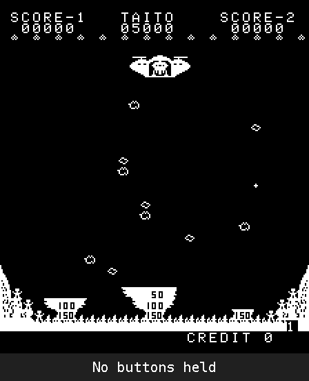 | 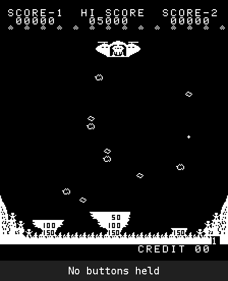 |

*Same buttons (P1 Start + Fire + Right) held in the attract demo, then released once the credit counter changes. Genuine: nothing. Destination Earth: 3 credits. Made with `scripts/trapdemo.py --gif`.*

Details: [docs/lunar-rescue.md](docs/lunar-rescue.md).

### Space Invaders Part II

Part II's trap is also in the extra ROM at `$4000`:

```
4186  mvi  h,$1F
4188  mvi  l,$E4
418A  inr  h
418B  dcr  l           ; HL = $20E3, the "armed" flag, built in pieces
418C  mov  a,m
418D  ana  a
418E  rz               ; not armed -> do nothing
418F  call $1F49       ; read player 1 controls
4192  ani  $76         ; keep Start1, Start2, Fire, Left, Right
4194  cpi  $36         ; = Start1 + Start2 + Fire + Left, nothing else
4196  rnz
4197  mvi  l,$EC
4199  dcr  l
419A  mvi  h,$1F
419C  inr  h           ; HL = $20EB, the credit counter
419D  mvi  m,$02       ; credits = 2
419F  mvi  l,$CC
41A1  mvi  m,$02       ; shadow copy = 2 as well (see below)
```

And this is what arms it, run over and over in attract mode:

```
459C  in   0           ; read input port 0
459E  ani  $0A         ; keep bits 1 and 3, the two lines Taito ties to ground
45A0  cpi  $0A
45A2  jz   $0000       ; both high -> reset the machine
45A5  ana  a
45A6  nop
45A7  rnz              ; exactly one high -> stay armed
45A8  lxi  h,$20E3     ; both low (Taito's wiring):
45AB  mvi  m,$00       ;   clear the flag, trap disarmed
45AD  ret
```

Part II hides the same idea more carefully than Lunar Rescue:

- **The credit address never appears in the code.** It's built at run time from neighbouring values
  (`MVI H,$1F / INR H` and `MVI L,$EC / DCR L` gives `$20EB`), so searching the ROM for `$20EB`
  won't find it.
- **Credits have a shadow copy** at `$20CC`. The interrupt handler compares the two every frame and
  restarts the game if they differ, so poking the credit counter in a debugger just resets the
  machine. The hidden routine writes both copies.
- **The trigger is the hardware, not the text.** The game keeps reading two input lines (port 0, bits 1 and 3)
  that do nothing else. According to the notes in MAME's driver, taken from Taito's schematic, both are **tied to
  ground** on Taito's board, while most of their unused neighbours are pulled high. Both low (Taito's wiring):
  trap disarmed. Both high (what an unconnected TTL input usually reads): the game resets itself. Exactly one
  high: the trap stays armed.

  Taito's own schematic of the I/O board (PV070010, "P.T-GAME P.C. BOARD", from
  [robotron-2084.co.uk](https://www.robotron-2084.co.uk/hardware/boardset/taito-space-invaders-part-ii-3-layer-board-stack))
  confirms it: every unused input of the four 74LS153 multiplexers that read the port has a 1k pull-up to +5V,
  except the two the code checks, which also have a **ground link on the same node**. So the check is looking for
  two specific ground links. A copier who missed both got a board that won't start; one who missed one, or wired
  it differently, got a board that gives free games. Whether Taito hid those links (under a chip, on the solder
  side, a jumper wire) or they were ordinary tracks, I can't tell from the code; owners of real Part II boards
  could check.

  Repairers already knew the reset half. In a 2022 [Arcade Museum forum thread](https://forums.arcade-museum.com/threads/taito-3-board-space-invaders-part-2-bad-shifter-causes-resets.504475/)
  about a resetting Part II board, HudsonArcade found the check ("it's resetting because the code is telling it
  to"), said it's "specifically to 'prevent' people from swapping ROMs as an upgrade" (Part II ROMs in a plain
  Space Invaders board), and gave the patch to disable it. What I couldn't find anywhere is the other half: with
  exactly one line wrong, the check doesn't reset, it arms a free-credit routine.
- **There's a second trap that doesn't work.** It's armed if five bytes of the program ROM have been
  changed, but it reads the controls through a helper that leaves a register pointing at ROM. Its
  "2 credits" are written into read-only memory and vanish. Whether that's a bug or a decoy, it never
  pays out.

| Genuine wiring (port 0 = `$00`) | One line high (port 0 = `$02`) |
|---|---|
| 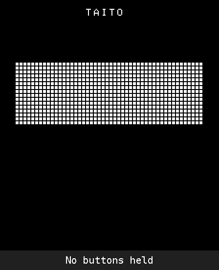 |  |

*`invadpt2`, P1 Start + P2 Start + Fire + Left held in the attract demo and then released: nothing with Taito's wiring, 2 credits with one of the two lines high. Made with `scripts/trapdemo.py --gif`.*

The add-on ROM also contains a cleaned-up version of the known Space Invaders "TAITO COP" easter
egg: it now spells "TAITO CORP", and its first step no longer needs Left and Right held at once.

Details, including the schematic, chip positions and the repair threads:
[docs/space-invaders-part-ii.md](docs/space-invaders-part-ii.md).

### It worked on real bootlegs

Scanning the 149 Taito-family sets in a MAME 0.277 collection and running each Lunar Rescue copy in the emulator:

| Set | Made by | Trap as shipped |
|---|---|---|
| **Destination Earth** (`desterth`) | bootleg | **live: the combo gives 3 credits** |
| **Escape from Mars** (`escmars`) | bootleg | **live: the combo gives 3 credits** |
| **Moon Lander, set 2** (`mlandera`) | Leisure Time Electronics (UK) | **live: the combo gives 3 credits** |
| Moon Lander, set 1 (`mlander`) | Leisure Time Electronics (UK) | armed but blocked: patched so the controls read nothing while idle |
| Rescate Lunar (`resclunar`) | Niemer S.A. (Spain) | disabled: `RZ`→`RET` at `$47E6`, plus its own ROM checksum |
| Lunar Rescue Model Racing / Artic copies, Galaxy Rescue | various | switched off: Taito copyright left intact |

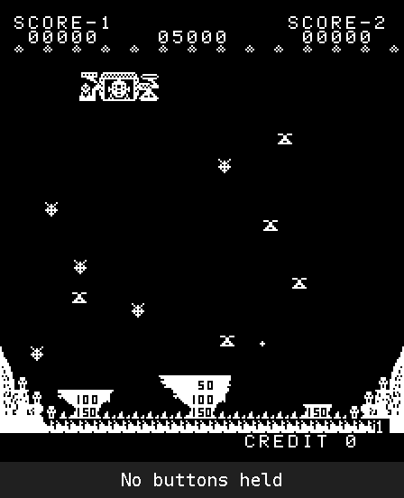

*`mlandera` as shipped, P1 Start + Fire + Right held in the attract demo and then released: 3 credits. Made with `scripts/trapdemo.py --gif`.*

Three pirate copies pay out free games. Two others don't: Rescate Lunar patches the trap out directly, and
the other Moon Lander set ignores the controls while the game is idle, which blocks it. The two Moon Lander sets
differ by exactly that: 25 bytes, every one of them part of the idle check. So one version of the
UK bootleg gave free games and the other didn't (which came first, and whether the fix was deliberate, isn't known).
A later byte-signature search of every 1975–85 set in that collection (2,497 zips, clones included) and in a
MAME 0.78 collection found the trap code in these two families and nowhere else.
All six Space Invaders Part II sets carry their trap too; Midway's *Space Invaders Deluxe* even updated one check to
match its own changes.

**Moon Base Zeta** (`moonbase`, Taito / Nichibutsu) is the near miss. It changed the five ROM bytes that Part II's
*second* trap checks, without updating the check. So that trap switches on, and in the emulator the combo
(P1 Start + P2 Start + Fire + Right) is accepted. But that trap has Taito's bug: it writes the "2 credits" into
read-only memory, so nothing pays out. Without the bug, Moon Base would have handed out free games.
(The second set, `moonbasea`, kept the original bytes, so the trap stays off there.)

Details: [docs/bootleg-results.md](docs/bootleg-results.md).

### So what was going on at the squash club?

The machine was an unmarked cocktail table: no maker's name, a very generic cabinet. Around the same time the club
also had unmarked Asteroids and Space Firebird machines, two on site at once, which sounds like an operator buying
copied boards.

If the machine was a Lunar Rescue copy with the Taito name changed (*Destination Earth* or *Escape from
Mars*, or the right version of *Moon Lander*, which was a UK bootleg), holding the combo during the attract demo
gave free credits, exactly as described above. I can't know which board it was, but the memory fits the code, and
those copies were real. A cocktail table makes no difference: the trap reads the player 1 controls whatever the
cabinet type. (Atari's Asteroids Deluxe trap, below, is in a different game from the club's Asteroids; nothing like it turned
up in the original Asteroids.)

---

## Atari, 1980

### Asteroids Deluxe: the copyright check that pays out

Asteroids Deluxe keeps **two copies** of its copyright line, "© 1980 ATARI INC". It draws the one at `$7603` on
screen and never displays the other, at `$7845`. When a game ends with a **new top score**, it redraws the line
from the hidden copy in a compare-only mode and checks every byte against what's on screen. A bootlegger who put
their own name in the copyright changed only the copy that is drawn, so the two differ, and a flag at `$91` is set
for good. Nothing visible happens. From then on, at the end of every game that makes the high-score table:

```
703B  LDA $91          ; copyright check failed earlier?
703D  BEQ $704A        ; no -> nothing
703F  LDA #$55
7041  CMP $2C0A        ; POKEY random number
7044  BCC $704A        ; above $55 (about 2 times in 3) -> nothing
7046  INC $93          ; credits + 1
7048  INC $93          ; credits + 1
```

`$93` is the credit count: the coin routine adds to it and Start takes from it, and nothing else writes it. So
the board pays out at random, only to people who play well, and only after someone has set a top score, which
makes it far harder to notice than Lunar Rescue's combo.

Simulating a bootleg in MAME (the copyright changed to "1980 ACME INC", one coin per game, the ship left alone):

| Genuine board | Copyright changed |
|---|---|
| 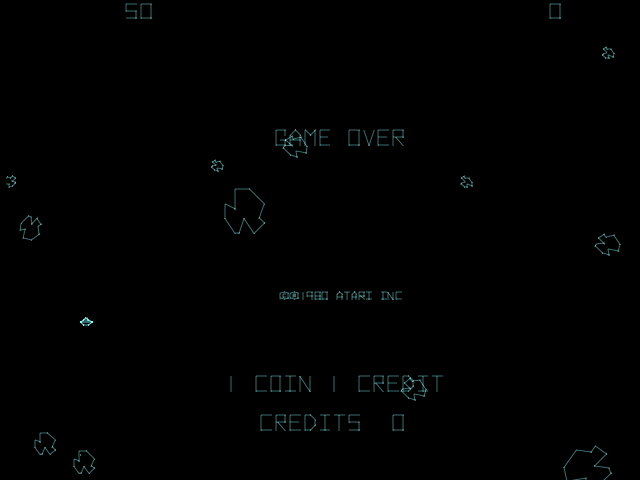 | 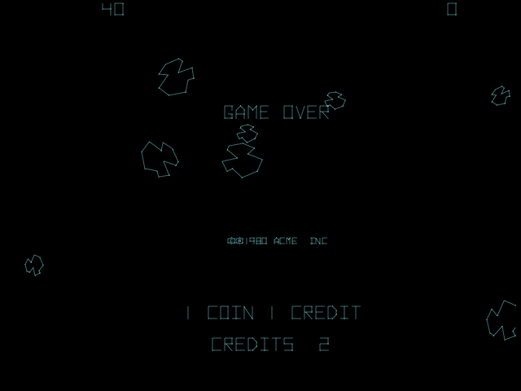 |

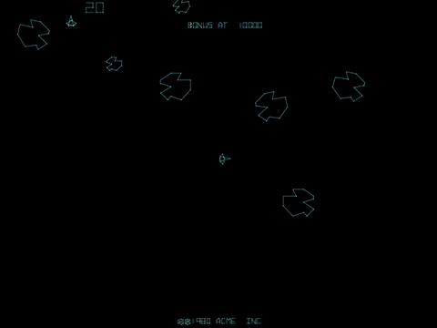

*The changed board at game over: as the initials screen appears, so does PRESS START. The board has just given
itself 2 credits. Over 42 game overs with the flag set, 12 paid out (the code's chance is 34%); on the genuine board,
none of 28 did. Made with `atari/astdelux_trap.lua`.*

Atari removed it: revision 2 still has it, revision 3 (MAME's `astdelux`) has none of it. The details page has the full listings, the Start and coin code, and two further checks I haven't traced yet.

Details: [docs/asteroids-deluxe.md](docs/asteroids-deluxe.md).

### Centipede: free credits without a genuine POKEY

At power-up and at the start of every game, Centipede puts its POKEY sound chip into reset, which freezes the
chip's random-number register. It then reads that register twice and adds the difference to the credit count:

```
28A2  LDA $100A        ; POKEY random number
28A5  EOR $100A        ; ... again: 0 on a genuine POKEY in reset
28A8  CLC
28A9  ADC $C8
28AB  STA $C8          ; credits = credits + difference
```

This one is known: the commented disassembly at
[6502disassembly.com](https://6502disassembly.com/va-centipede/Centipede_rev4.html) calls it "add credits if it's
not a POKEY". What the MAME sets add is the bootleggers' side. Four Centipede bootlegs replace the POKEY with a cheaper General
Instrument sound chip. **Caterpillar** and one set of **Magic Worm** (the bootleg Atari took to court) changed these
two reads to read the same byte twice, so the difference is always 0; the other Magic Worm set removed the check;
two more bootlegs left it alone.

| Genuine POKEY | Random register not frozen |
|---|---|
| 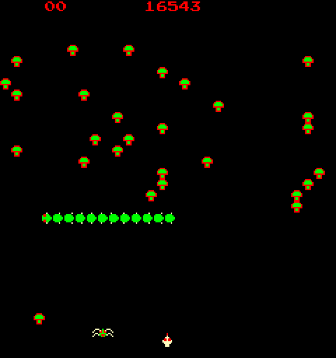 | 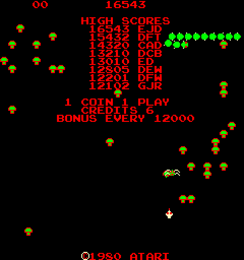 |

*Straight after power-up, before any coin. Made with `atari/centipede_trap.lua`, which makes only those two
reads differ.*

Details: [docs/centipede.md](docs/centipede.md).

---

## The "kick me for a free game" story

Ned Batchelder [heard a story](https://nedbatchelder.com/blog/200404/arcade_copy_protection) at General Computer
(Ms. Pac-Man's developers) in 1982: a game that, if its copyright notice is missing, shows "KICK ME FOR A FREE GAME"
and gives a credit each time the cabinet's slam switch trips. I looked for it in the games closest to the story
(Missile Command, General Computer's Super Missile Attack, Ms. Pac-Man), searched every 1975–85 set for the
wording, and scanned all 112 sets that use Atari's standard coin routine for a slam-switch read that leads to a
credit. **Not found**: in every one, the slam switch only blocks coins for a moment, and Ms. Pac-Man's board has
no slam switch at all. That search is what turned up Asteroids Deluxe and Centipede.

Details: [docs/kick-me-hunt.md](docs/kick-me-hunt.md).

## Bonus: the easter egg that travelled

Space Invaders' hidden "TAITO COP" message turns up in other companies' games built on Taito's code. In
**Space Stranger** (1978, the ROM says "HOEI CORP") the egg was moved to the new board's input port and its
message changed to **"HOEI COP"**. It still works: hold P2 Start + Fire + Left during the demo, then P1 Start
+ Fire. Nichibutsu's **Rolling Crash** kept the egg's code but blanked its message to spaces.

| Space Invaders | Space Stranger |
|---|---|
| 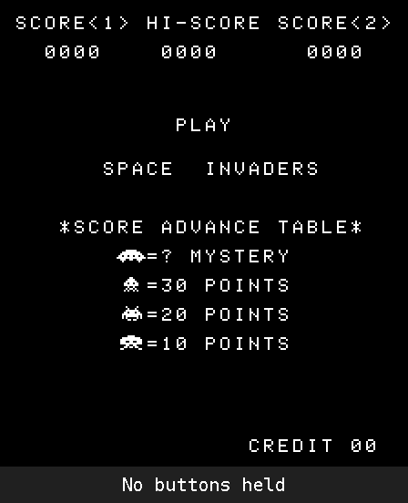 | 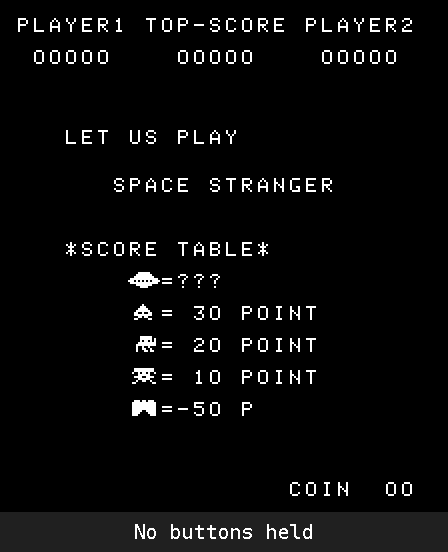 |

*The two button combinations as the emulator runs them. Made with `scripts/eggdemo.py --gif`.*

Details: [docs/easter-egg-travelled.md](docs/easter-egg-travelled.md).

## Was this policy?

On the evidence so far, it was a tactic of 1979–80, when copied boards were everywhere:

- **Taito:** the original 1978 Space Invaders has no trap, only an easter egg. Both 1979 games put the trap in the
  **add-on ROM at `$4000`** and tie it to an anti-copy check. Through the 1980s Taito moved to **hardware
  protection**: custom microcontrollers the game can't run without. Since checked: Balloon Bomber, Lupin III,
  Polaris, Space Chaser, Indian Battle and Steel Worker (no trap), and the Z80 games that followed: Crazy Balloon,
  Space Cruiser, Space Seeker, Alpine Ski, Wild Western, Jungle King, Front Line, Elevator Action (no trap). The
  Elevator Action bootleg had to patch nine places to run without Taito's 68705 protection chip: by 1983 the
  protection lived in hardware.
- **Atari:** Centipede (revisions 1, 2 and 4, the ones checked) and the first two revisions of Asteroids Deluxe pay out on copies; Asteroids
  Deluxe revision 3 drops it. Atari's other tricks of the time were evidence and sabotage rather than payouts:
  Centipede's hidden Morse-code signature, used in court, and checksums such as Tempest's.

## How it was found

1. Disassembled the program ROMs: Intel 8080 for the Taito games, 6502 for the Atari ones. (Atari's Lunar Lander was
   checked first as a control, an unrelated 1979 game on a 6502, and is clean: see [docs/lunar-lander-clean.md](docs/lunar-lander-clean.md).)
2. Found the credit counter by inserting coins in the emulator, then traced **every** instruction that writes it.
   Anything other than "coin in" and "start pressed" is suspicious.
3. Ran the Taito ROMs in a purpose-built 8080 emulator of the Space Invaders board, held the combos, and
   simulated a bootleg by altering one letter of "TAITO". The credits appeared; on the unmodified ROM
   they don't.
4. Turned the patterns into a scanner, which finds every hidden routine above and, on the original
   Space Invaders, only the known easter egg.
5. For the Atari games, scanned every set that uses Atari's coin routine (`atari/slamscan.py`), went through every
   remaining credit write by hand, and confirmed each trap in MAME with Lua scripts that play the game unattended,
   on a genuine and a simulated bootleg board.

## Try it yourself

ROMs are not included; use your own MAME sets (the results here are from MAME 0.277 sets).

**Taito** (pure Python 3: a disassembler, a signature scanner and an 8080 emulator of the Space Invaders board):

```bash
python3 trapscan.py scan lrescue.zip invadpt2.zip     # report + disassembly
python3 trapscan.py run lrescue.zip --frames 1720 --patch 4676=13 \
    --hold start1+fire+right@1600-1700 --watch 20eb     # bootleg simulation -> credits 03
python3 scripts/verify.py ~/roms                       # check every Taito listing against the ROMs
```

In MAME's debugger:

- **Lunar Rescue:** after **both** title screens (~10 s from power-on), enter `b@20ed=1`, then hold
  P1 Start + Fire + Right once the demo starts.
- **Space Invaders Part II:** the board check clears the flag again and again during attract mode, so set it at
  the moment the trap reads it: `bpset 418c,1,{b@20e3=1;g}`. Reset, and hold P1 Start + P2 Start + Fire + Left
  from power-on; the trap runs about 4 seconds in, and the credits go to 2.

**Atari** (MAME's Lua scripting; the scripts play by themselves and print the credit count):

```bash
mame astdelux1 -autoboot_script atari/astdelux_trap.lua              # copyright changed: +2 credits at some game overs
TAMPER=none mame astdelux1 -autoboot_script atari/astdelux_trap.lua  # genuine: never
mame centiped -autoboot_script atari/centipede_trap.lua              # reads differ: +3 credits per game start
python3 atari/verify_atari.py ~/roms                                 # check every Atari listing against the ROMs
python3 atari/slamscan.py ~/roms -o slamscan.md                      # the slam-switch scan
```

Add `-nothrottle` to run faster than real time. On Windows PowerShell, set the variable first: `$env:TAMPER="none"`.

To search a whole collection, any manufacturer, for the Taito trap code and its arming checks: `sigsearch.py`.
Full instructions: [docs/USAGE.md](docs/USAGE.md). Sets worth collecting: [docs/ROMLIST.md](docs/ROMLIST.md).

## Caveats

- Confirmed by disassembly and emulation, **not yet on real hardware**.
- Z80 games are scanned statically (no Z80 emulator yet).
- Which real boards had one of the Part II input lines high is unknown. MAME leaves them low (Taito's wiring),
  so the trap is off there unless you poke the flag. If you have a genuine or bootleg Part II board: are port 0
  bits 1 and 3 (both grounded on Taito's schematic) really tied low on yours, and how is that link made? Does the
  combo work? An issue on this repo with the answer would settle it.
- The Asteroids Deluxe bootleg is simulated (I don't know of a dumped bootleg of revision 1 or 2 with its copyright
  changed). Two more checks in that game, one during play and a ROM checksum, are not traced yet.
- The Centipede demonstration changes only the two reads at the check, to show its effect; a real board without a
  POKEY would differ in other ways too.
- "Right" means bit 6 of input port 1, the standard Space Invaders wiring.
- "Not documented before" means I couldn't find it online, in TCRF, Computer Archeology, 6502disassembly.com or the
  arcade history databases. If you know otherwise, open an issue; I'd love to hear it.

## Prior art

Other anti-copying tricks from the same era that are documented:

- **Centipede (Atari, 1980)** adds credits when its POKEY isn't genuine (above), and hid a data pattern that spells
  "COPYRIGHT 1980 ATARI" in Morse code once decoded. The Morse pattern does nothing at run time; Atari used it as
  evidence in court that the bootleg *Magic Worm* was copied from its code
  ([Arcade Blogger](https://arcadeblogger.com/2019/06/29/atari-centipedes-hidden-code-trap/),
  [6502disassembly.com](https://6502disassembly.com/va-centipede/Centipede_rev4.html)).
- **Donkey Kong (1981)** checks part of "NINTENDO" in its copyright line and freezes if it has been changed
  ([TCRF](https://tcrf.net/Donkey_Kong_(Arcade))).
- **Tempest (1981)**: a buggy anti-piracy checksum in the first revision could award 40 free credits; Atari
  fixed it in revision 2 ([TCRF](https://tcrf.net/Tempest_(Arcade))).
- **Space Invaders Part II's board check:** its reset was identified by repairers in 2022, as a guard against
  ROM-swap upgrades, with the patch to remove it
  ([Arcade Museum forum](https://forums.arcade-museum.com/threads/taito-3-board-space-invaders-part-2-bad-shifter-causes-resets.504475/),
  [UKVAC](https://www.ukvac.com/forum/threads/taito-3-pcb-invaders-boardset-resetting.75648/)); MAME's driver notes
  the two lines are tied low on Taito's schematic. The credit trap behind the same check hasn't been described.
- **Space Dungeon (Taito America, 1981)** has an untriggered message, "STOLEN FROM THE GOOD BUDDY'S AT TAITO
  BY AN UNAUTHORIZED DO BADDER" ([TCRF](https://new.tcrf.net/Space_Dungeon)).
- General Computer's "kick me for a free game" story, told second-hand
  ([Ned Batchelder](https://nedbatchelder.com/blog/200404/arcade_copy_protection)); not found, see above.

What's different here: the Lunar Rescue, Part II and Asteroids Deluxe traps actually run, they're tied to a copy
check, and the Lunar Rescue one pays out on real bootlegs (Destination Earth, Escape from Mars, one version of Moon
Lander).

## References

- [The Cutting Room Floor: Space Invaders (Arcade)](https://new.tcrf.net/Space_Invaders_(Arcade)), the "TAITO COP" easter egg
- [Computer Archeology: Space Invaders](https://www.computerarcheology.com/Arcade/SpaceInvaders/), hardware and original code
- [6502disassembly.com: Centipede](https://6502disassembly.com/va-centipede/Centipede_rev4.html), commented disassembly
- [arcade-history.com: Lunar Rescue](https://www.arcade-history.com/game/1418/)
- [MAME machine data: Space Invaders Part II](https://data.spludlow.co.uk/mame/machine/invadpt2)
- MAME's driver sources (`8080bw.cpp`, `asteroid.cpp`, `centiped.cpp`, `pokey.cpp`), for memory maps, inputs and
  POKEY behaviour
- [List of Taito games (Wikipedia)](https://en.wikipedia.org/wiki/List_of_Taito_games)
- [robotron-2084.co.uk: Taito Space Invaders Part II 3-layer board stack](https://www.robotron-2084.co.uk/hardware/boardset/taito-space-invaders-part-ii-3-layer-board-stack), board photos and Taito's
  schematics (CPU AA017757, ROM AA017756A, I/O and sound PV070010); thanks for making them available
- Arcade Museum forum (HudsonArcade, Lurch666 and others) and UKVAC, for the repair-side knowledge of Part II's
  board check

*Mark Hawkings, Bexley, 2026.*

Licence: MIT
