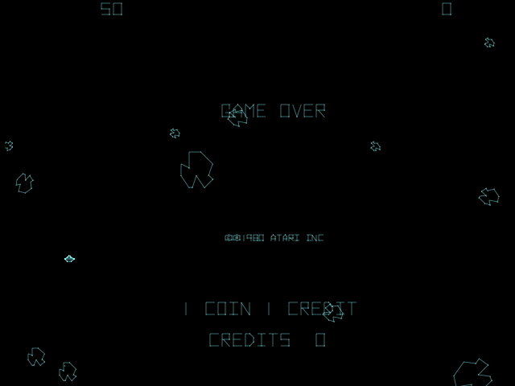
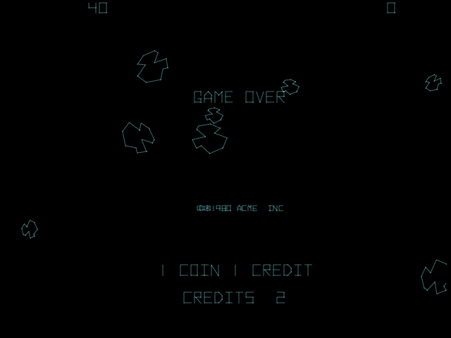
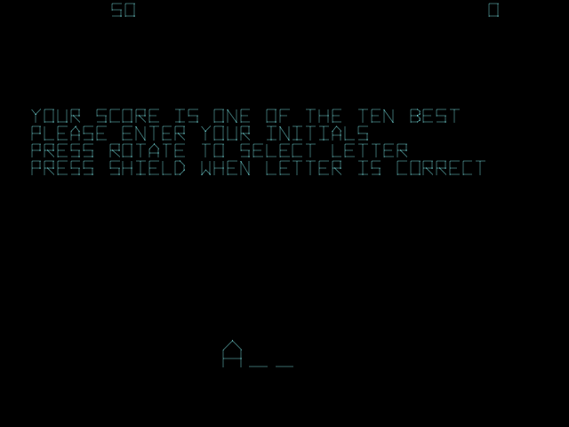
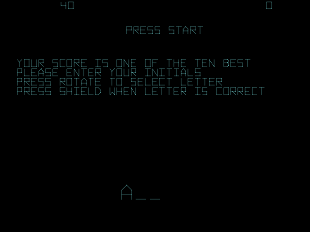
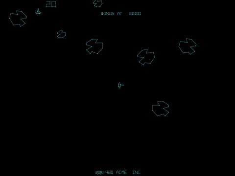

# Asteroids Deluxe (Atari, 1980–81) – the copyright check that pays out

MAME sets: `astdelux1` (revision 1), `astdelux2` (revision 2), `astdelux` (revision 3). 6502 CPU.
Program ROMs: 036430 $6000, 036431 $6800, 036432 $7000, 036433 $7800. Code also runs from the "vector ROM"
area: 036800 $4800 and 036799 $5000. Work RAM $0000–$03FF, vector RAM $4000–$47FF, POKEY $2C00 (random number
`$2C0A`), inputs $2000/$2400 (one bit per address, read in bit 7). The addresses below are revision 1.

## Credits

- Credit count: **`$93`**.
- Coins add to it in Atari's standard coin routine (`$7971`/`$7973`: `INC $93`, once or twice depending on the
  pricing switches).
- Start takes it away (`$4C7C`, in the 036800 ROM):

```
4C7C  LDY $93          ; credits
4C7E  LDX #$01
4C80  LDA $2403        ; Start 1 pressed?
4C83  BMI $4CA5        ; yes -> one-player game
4C85  CPY #$02
4C87  BCC $4CD2        ; fewer than 2 credits -> no two-player game
4C89  LDA $2404        ; Start 2 pressed?
4C8C  BPL $4CD2
 ...
4CA1  LDX #$02
4CA3  DEC $93          ; two-player game costs a second credit
4CA5  STX $22          ; game on: 1 or 2 players
4CA7  DEC $93          ; credits - 1
```

Besides those, exactly one other instruction pair writes `$93`, and it adds two.

## The payout ($7032, at the end of every game)

This runs once as a game ends, straight after the high-score table has been checked. `$D5` is the player's place
in the table: negative if they didn't make it, 0 for a new top score.

```
7032  LDX $D5          ; did the player make the high-score table?
7034  BMI $7055        ; no -> skip everything below
7036  LDY #$4F
7038  JSR $775B        ; (sound)
703B  LDA $91          ; the "tampered" flag
703D  BEQ $704A        ; clear -> no payout
703F  LDA #$55
7041  CMP $2C0A        ; POKEY random number
7044  BCC $704A        ; above $55 (about 2 times in 3) -> no payout
7046  INC $93          ; credits + 1
7048  INC $93          ; credits + 1
704A  TXA
704B  BNE $7055        ; not a new top score -> done
704D  SEC
704E  ROR $90          ; switch the text routine to compare mode
7050  JSR $77F5        ; compare the copyright (below)
7053  LSR $90          ; back to draw mode
7055  LDA #$00
7057  STA $22          ; game over
```

So once `$91` is set, every game that ends on the high-score table has an 86-in-256 chance (about 1 in 3) of
adding 2 credits.

## What sets the flag: two copies of the copyright line

The text "© 1980 ATARI INC" is stored **twice**, packed three characters to two bytes (5 bits each):

| Address | ROM | Bytes | Used for |
|---|---|---|---|
| `$7603` | 036432-01 +0603 | `1F C4 09 70 2D 9A 0B 64 38 00` | drawn on screen (`$7168` sets the text pointer, at power-up and after each game) |
| `$7845` | 036433-01 +0045 | `1F C4 09 70 2D 9A 0B 64 38 00` | the reference copy, used only by the check |

The on-screen copy is drawn into vector RAM at `$4702`. On a new top score, `$77F5` points at that vector RAM,
switches the text routine into compare mode (`$90` bit 7), and redraws the copyright from the **reference** copy.
Instead of writing, each byte it would write is compared with what's already there:

```
77F5  BIT $90
77F7  BPL $7834        ; not in compare mode -> return
 ...
77FF  LDA #$47
7801  STA $04
7803  LDA #$02
7805  STA $03          ; ($03) = $4702, where the on-screen copyright was drawn
 ...                   ; compare the fixed bytes in front of the text
7823  LDA #$45
7825  STA $09
7827  LDA #$78
7829  STA $0A          ; text = the reference copy at $7845
782B  JSR $71BD        ; "draw" it: in compare mode every byte goes through $7835
 ...
7835  EOR ($03),Y      ; differs from what is in vector RAM?
7837  ORA $91
7839  STA $91          ; ... then remember it, for good
783B  INY
783C  RTS
```

A bootlegger who put their own name in the copyright, and changed the text the game draws, leaves the reference
copy alone. The two no longer match and `$91` is set. Nothing visible happens, and the payouts start from the next
game over on the high-score table.

`$91` is also set by a second check during play, which compares two bytes of vector memory with `$81 $C3`
(`$6083`, `$610E`, `$60CB`). I haven't worked out what that one detects. There's also a background checksum of the
program ROMs every 256 frames (`$6051`–`$6089`, result in `$8C`), which changes something during play when it
fails (`$6414`); not traced.

## Revisions

| Set | Payout and copyright check | ROM checksum |
|---|---|---|
| `astdelux1` (revision 1) | yes | yes |
| `astdelux2` (revision 2) | yes (it shares the first three program ROMs with revision 1; its own last ROM keeps `$7835`) | yes |
| `astdelux` (revision 3) | **removed**: no `CMP $2C0A` after `LDA #$55`, no compare helper | removed (the space is used by difficulty code) |

## In MAME

`atari/astdelux_trap.lua` runs the game unattended: it changes the on-screen copyright to "1980 ACME INC" (ROM bytes
`$7606`–`$7608` to `4E 8A 42`) and resets, inserts a coin every two minutes, lets the ship die, and empties the
high-score table at each game start so every game ends with a new top score. `TAMPER=none` runs the genuine board.

| Genuine board | Copyright changed to "ACME" |
|---|---|
|  |  |
|  |  |

*Top: the attract screen after the same sequence (one coin per game, the ship left alone). Bottom: the moment the
game ends. On the changed board "PRESS START" appears on the initials screen because the board has just given
itself 2 credits.*



Results from unattended runs:

| Board | Runs | Game overs | Copyright check | Game overs that paid +2 |
|---|---|---|---|---|
| Genuine | 4 | 28 | passed every time | 0 |
| Copyright changed | 7 | 42 after the flag was set | failed on the first new top score | 12 of 42 (29%; the code's chance is 86 in 256, 34%) |

In MAME's debugger, by hand: `bpset 7046` never hits on a genuine board. To simulate the bootleg without a script,
set the flag once a game is running (`b@91=1`) and play to a high-score entry; about one game in three, credits
go up by 2.

## Not found documented

I couldn't find this in MAME's driver notes, arcade-history.com, Atari Compendium or The Cutting Room Floor. The
commented 6502 disassemblies at [6502disassembly.com](https://6502disassembly.com/) cover Asteroids, not
Asteroids Deluxe. Corrections welcome.
