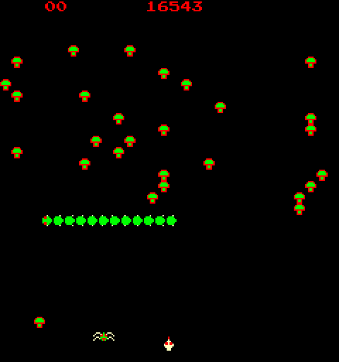
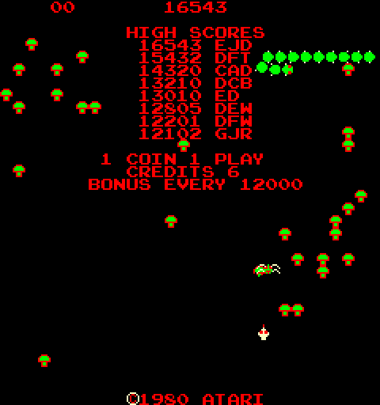

# Centipede (Atari, 1980) – free credits on boards without a genuine POKEY

MAME set `centiped` (revision 4) and clones. 6502 CPU. Program ROMs 136001-407 to -410 at $2000–$3FFF; POKEY at
$1000 (`$100A` = random number, `$100F` = SKCTL). Credit count: **`$C8`** (BCD).

**This one is already documented**: the commented disassembly at
[6502disassembly.com](https://6502disassembly.com/va-centipede/Centipede_rev4.html) labels it *"add credits if it's
not a POKEY"*. What's added here is how the bootleggers dealt with it, and a demonstration in MAME.

## The check ($2876, at power-up and at the start of every game)

```
2891  LDA #$00
2893  STA $100F        ; SKCTL = 0: POKEY into reset, its random-number generator stops
 ...                   ; (clear sound channels and scores)
28A2  LDA $100A        ; read the random number
28A5  EOR $100A        ; ... and again: on a real POKEY in reset, the same value, so this is 0
28A8  CLC
28A9  ADC $C8
28AB  STA $C8          ; credits = credits + difference
28AD  LDA #$03
28AF  STA $100F        ; POKEY back on
```

On a genuine POKEY the two reads are identical and nothing is added. On a board whose random register doesn't stop
(no POKEY, or something standing in for one), the reads differ and the game adds the difference to the credits,
every time a game starts. MAME's POKEY emulation follows the real chip: in reset the generator is held, and reads
return the same value.

All of Atari's sets carry it: revision 4 at `$28A2`, revisions 1 and 2 three bytes earlier (and so does Centipede Dux,
a 1989 hack).

## What the bootlegs did

Four Centipede bootlegs in MAME replace the POKEY with a cheaper General Instrument AY-3-8910/8912 sound chip. Two
of them changed the check; two left it as Atari wrote it:

| Set | Sound chip | Code at the check |
|---|---|---|
| `centiped` (Atari) | POKEY | `LDA $100A / EOR $100A` |
| `magworm`, Magic Worm set 1 (Sidam bootleg) | AY-3-8912 | removed: the bytes now set up the AY chip (`LDA #$07 / STA $1001 / LDA #$31 / STA $1003`, then `JSR $3069 / NOP / NOP / NOP`) |
| `magworma`, Magic Worm set 2 (bootleg) | AY-3-8912 | `LDA $E2 / NOP / EOR $E2 / NOP`: reads a RAM byte twice, always 0 |
| `caterplr`, Caterpillar (Olympia bootleg) | AY-3-8910 | `LDA $289F / EOR $289F`: reads a ROM byte twice, always 0 |
| `centipdb`, `millpac` (Millpac: Valadon Automation) | AY-3-8910 | unchanged |

Leaving it in can be harmless: if address `$100A` returns the same value twice on the bootleg board, Atari's code
adds nothing. What `$100A` reads on each of these boards isn't known, so neither is why two makers changed the
check and two didn't.

Magic Worm is the bootleg that Atari took to court using Centipede's hidden Morse-code signature
([Arcade Blogger](https://arcadeblogger.com/2019/06/29/atari-centipedes-hidden-code-trap/)).

## In MAME

`atari/centipede_trap.lua` changes only the two reads at `$28A2`/`$28A5` so that they differ by 3, as on a board
whose random register kept running. (Faking the random register everywhere doesn't work: Centipede checks for a
genuine POKEY in other places too, and resets.) `NOPOKEY=0` runs the genuine board.

| Genuine POKEY | Random register not frozen |
|---|---|
|  |  |

*Straight after power-up, before any coin. The check also runs at power-up, so the second board starts with 3
credits. After that, each coin adds 1 and each Start costs 1 but adds 3: 6, 9, 12... On the genuine board each Start costs
a credit as normal.*
