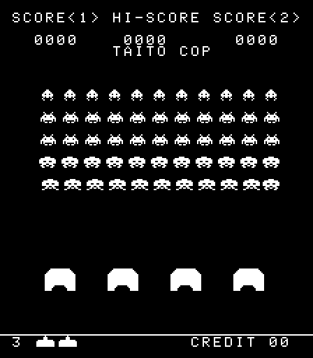
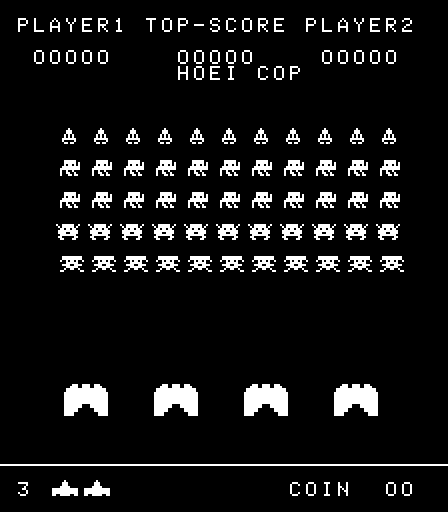
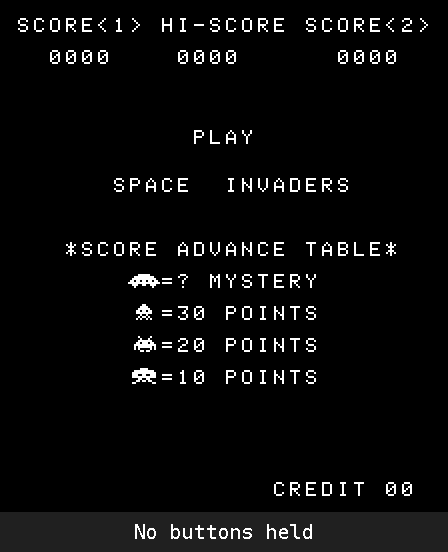
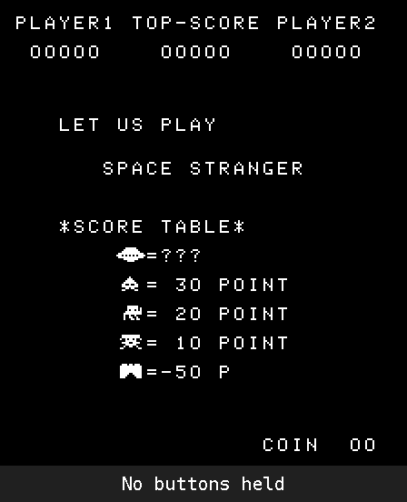

# The easter egg that travelled: "TAITO COP" in other companies' games

Space Invaders (1978) has a well-known hidden message: during the attract-mode demo, hold one button
combination, then another, and "TAITO COP" appears under the scores
([The Cutting Room Floor](https://new.tcrf.net/Space_Invaders_(Arcade))).

Searching a MAME 0.277 collection for the egg's two button checks (`ANI $76 / SUI $72` and `ANI $76 / CPI $34`)
found them, at the same addresses as in Space Invaders, in games from two other companies. Each had copied
Taito's program and kept the egg routine, and each did something different with its message.

| Game | Maker (ROM text) | Egg routine | Reads controls on | Message |
|---|---|---|---|---|
| Space Invaders (`invaders`) | Taito | $199A–$19BD, called from $0BF1 during the demo | port $01 | `TAITO COP` |
| **Space Stranger** (`sstrangr`, 1978) and Space Stranger 2 (`sstrangr2`, 1979) | "HOEI CORP" (MAME credits Yachiyo Electric) | same addresses, byte for byte | **port $42** (updated) | **` HOEI COP`** |
| **Rolling Crash / Moon Base** (`rollingc`) | "NICHIBUTSU CORP" | same addresses, still called | port $01 | **nine blank spaces** |

About 70% of the first 8 KB of both Space Stranger and Rolling Crash is byte-for-byte identical to Space
Invaders.

 

 

*Left: Space Invaders. Right: Space Stranger. The screenshots and the GIFs underneath (the held buttons are
named in the caption strip) are from this repo's emulator (`scripts/eggdemo.py`).*

## Space Stranger: rebranded, and still working

Space Stranger's board moves the controls to a different input port ($42) and drops Space Invaders' shift
register chip. The game's code was changed to match, including the egg: it reads port $42 too, and its
message was changed from "TAITO COP" to " HOEI COP". Whether Hoei found the egg and rebranded it, or replaced
every "TAITO" in the ROM without knowing what that one was for, can't be told from the code.

The changed input port also changes the button sequence. On Space Stranger the egg's mask ($76) covers port
$42 bit 4, which is the cabinet switch and reads 1 on an upright cabinet, so the sequence is:

1. during the attract demo, hold **P2 Start + Fire + Left**,
2. then **P1 Start + Fire**.

"HOEI COP" appears under the scores. On a cocktail table, bit 4 reads 0 and the egg can't trigger.
(Space Invaders' own sequence is P2 Start + Fire + Left + Right, then P1 Start + Fire + Left.)

Confirmed in this repo's emulator, which has a Space Stranger board (`trapscan/boards.py`, from MAME's
`sstrangr.cpp`: inputs on $41/$42/$44, one RST 7 interrupt twice a frame).

## Rolling Crash: wiped

Nichibutsu's Rolling Crash (MAME's title: "Rolling Crash / Moon Base"; not the Part II-based Moon Base Zeta) keeps the egg routine unchanged, still called during the
demo, still reading port $01. But the nine characters it prints have been overwritten with spaces, while the
copyright text next to it was changed from "TAITO CORPORATION" to "NICHIBUTSU CORP". That looks deliberate:
someone saw "TAITO COP" in the data and blanked it, without removing the code. Triggered, it draws nothing.
(This one is from the code only: Rolling Crash's colour video hardware isn't emulated here.)

## A false lead: Space Battle

MAME's Space Battle set (`sbhoei`) also matched the search, but only because it includes one extra 8 KB chip
that is byte-for-byte Space Stranger 2's program ROM (`4764.4k` = `sstrangr2/4764.09`). Space Battle's own
program runs on a different processor and has no egg.

## Try it

```bash
python3 scripts/eggdemo.py invaders.zip     # -> taito-cop.png (add --gif for taito-cop.gif)
python3 scripts/eggdemo.py sstrangr.zip     # -> hoei-cop.png (add --gif for hoei-cop.gif)
```

In MAME: start Space Stranger, wait for the demo game, hold P2 Start + Fire + Left until it's taken (a second
or two), then switch to P1 Start + Fire.

As far as I could find, neither the HOEI COP egg nor the blanked one in Rolling Crash has been written up
before; corrections welcome.
